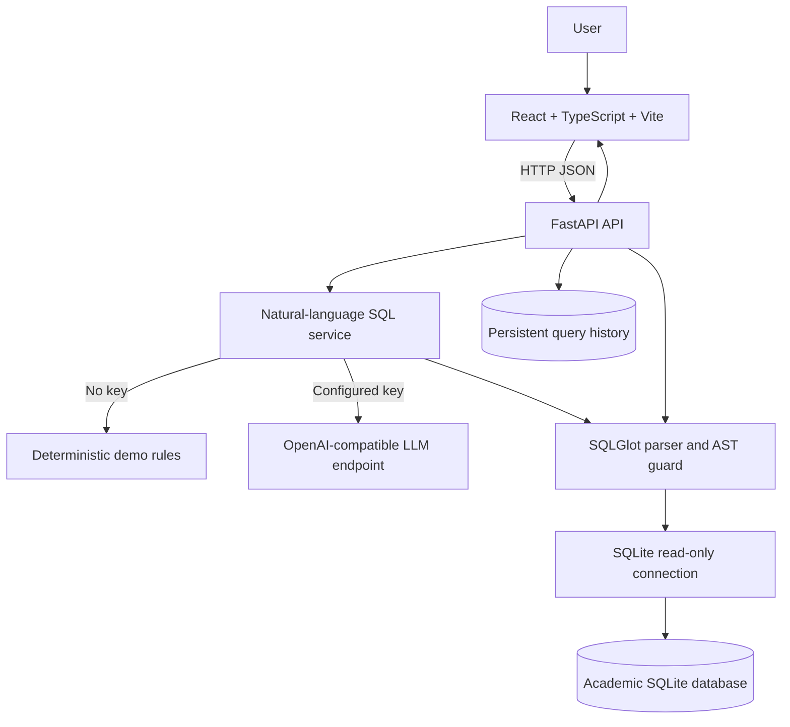
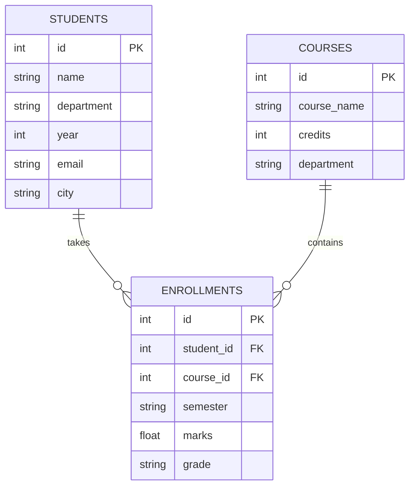

# QueryGPT Architecture

## Request lifecycle
1. The frontend sends a question to `/api/query` or asks `/api/generate` for SQL only.
2. The generator reads the current schema for the LLM prompt. Without an API key, a deterministic set of supported prompt patterns is used and the response identifies `mode: demo`.
3. SQLGlot parses the complete SQL input. Exactly one read-only SELECT-family statement is accepted; write/DDL commands, PRAGMA, extension/file functions, and qualified external database names are rejected.
4. The SQL is canonicalized and given a maximum row limit when one is not already present.
5. SQLite is opened in read-only mode for execution. Query results and timing are returned and the outcome is saved to the persistent history table.
6. The frontend renders actual rows and offers CSV export.

## Data model
- `students`: student identity and academic attributes.
- `courses`: course catalog.
- `enrollments`: join table with student/course foreign keys, semester, marks, and grade.
- `query_history`: persisted questions, SQL, mode, status, count, duration, errors, and timestamp.

